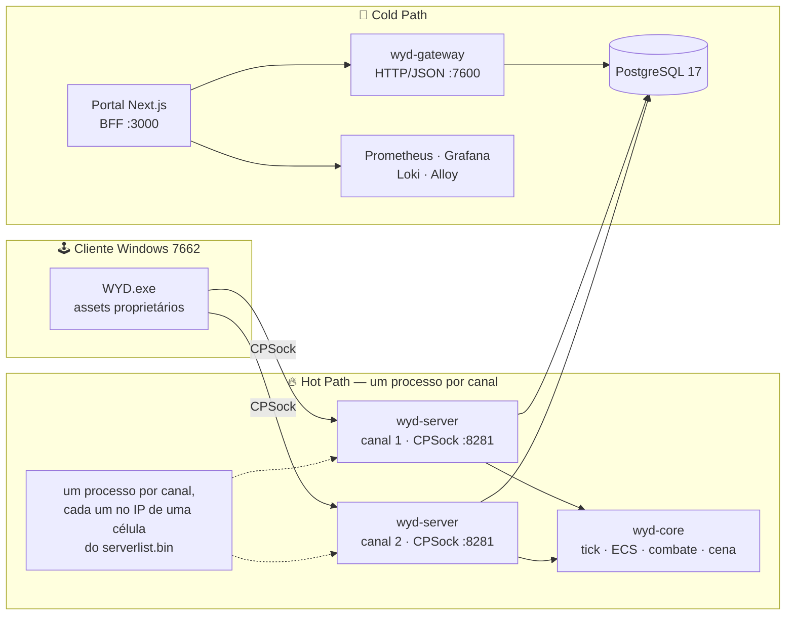
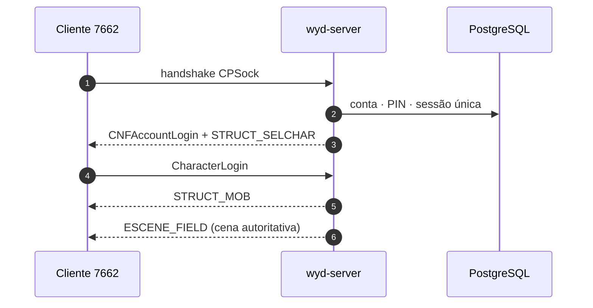

<a id="top"></a>

<div align="center">

# ⚔️ WYD2 — Servidor Rust

**O clássico *With Your Destiny* reconstruído com um Hot Path em Rust, PostgreSQL e um portal de operação em Next.js.**

<p>
  <a href="https://github.com/lucascantarelli/wyd/actions/workflows/ci.yml"></a>
  
  
  
  
  
</p>

<p>
  
  
  
</p>

**Servidor em desenvolvimento ativo.** O cliente Windows 7662 é proprietário e externo ao
repositório; algumas provas visuais ainda dependem dele.

[🚀 Começar](#comecando) · [🏗️ Arquitetura](#arquitetura) · [📚 Documentação](#documentacao) · [🗺️ Roadmap](#roadmap) · [🤝 Contribuir](#contribuindo)

</div>

---

## ✨ O que é este projeto

O **WYD2** é um servidor de MMORPG com o protocolo CPSock do cliente original e um motor
próprio em Rust. O objetivo é preservar a experiência do *With Your Destiny* — login, seleção
de personagem, cena, combate, inventário, economia e progressão — com uma base moderna,
determinística e observável.

| 🧩 Camada | 🛠️ Tecnologia | 🎯 Papel |
|---|---|---|
| **Hot Path** | Rust · `wyd-core` · `wyd-net` · `wyd-protocol` | tick, ECS, combate, cena, CPSock; um processo por canal |
| **Persistência** | PostgreSQL 17 · `sqlx` · `wyd-db` | personagens, inventário, economia, auditoria, migrations no boot |
| **Cold Path** | Rust · `wyd-admin` / `wyd-gateway` | HTTP/JSON administrativo, autenticação e integração com o portal |
| **Portal** | Next.js 16 · React 19 · TypeScript | BFF e telas de staff; nunca fala SQL nem escreve no estado vivo |
| **Launcher** | Rust · Tauri | manifesto, patch atômico, `serverlist.bin`, instalação e atualização |
| **Observabilidade** | Prometheus · Grafana · Loki · Alloy | métricas do motor, dashboards, alertas e logs duráveis |
| **QA** | `cargo test` · `wyd-bots` · Playwright | unidade, integração, fio, carga, bots e E2E do portal |

> 🧭 **Transição concluída:** a stack Go/C++ foi removida em 2026-11. A fonte canônica é
> `crates/` + `docs/` + `roadmap-rust/`; o histórico antigo serve apenas como referência
> arqueológica.

<a id="arquitetura"></a>

## 🏗️ Arquitetura



**Regra de ouro:** o cliente não dita posição, dano, cooldown ou inventário. O servidor é a
autoridade; o portal é BFF e não escreve no estado vivo. Grants administrativos passam pela
`delivery_queue`, com idempotência e auditoria.



## 📊 Estado atual

> Números medidos em **2026-11-13** pelo roadmap e pelo checklist funcional.

| Indicador | Estado |
|---|---|
| 🗺️ Roadmap | **34 issues ativas** + 15 descritores de fase · **58 concluídas** |
| 🧪 Checklist funcional | **35 ✅ · 23 🚧 · 34 ⬜ · 2 ⛔** em 94 linhas |
| 🗄️ Banco | **50 migrations · 86 tabelas** no gate atual |
| 🧱 Workspace | **9 crates Rust** + `apps/launcher-ui` (Tauri) |
| 🌐 Stack local | 2 canais + gateway + portal + PostgreSQL + Prometheus/Grafana/Loki |
| 🖥️ Cliente | 7662 externo; prova visual de `BUG-01`, `BUG-02`, `GAME-17` e `GAME-18` pendente |

### ✅ Já funciona com prova

- Login por conta e **PIN numérico** com Argon2id, bloqueio persistido e sessão única entre canais.
- Seleção/criação de personagem, entrada no mundo e cena autoritativa `ESCENE_FIELD` (30000).
- Tick determinístico, ECS, spatial grid, IA de NPC e combate interno.
- Loot até o inventário, refino com SancRate/piedade e `SendItem` no fio.
- Portal de staff com contas, moderação, auditoria, entregas idempotentes e financeiro.
- Gateway, migrations no boot, seed de staff, monitoramento e E2E Playwright.

### 🚧 Ainda em aberto

- **Prova visual no cliente 7662** para mensagens de entrada, PIN, cena e Campo de Treinamento.
- Lojas/diálogo de NPC, caixa de drop no chão, trade jogador↔jogador e skills no fio.
- Cobertura completa de carga, concorrência, banco e build de produção.
- Curva de crescimento e reorganização final do roadmap.

> ⛔ O que depende de captura/RE do cliente não é “código faltando”: é uma decisão de layout
> **UNVERIFIED**. O caminho conservador é tolerar, logar e não inventar contrato.

<a id="comecando"></a>

## 🚀 Começando

### Pré-requisitos

| Ferramenta | Necessário para |
|---|---|
| 🦀 **Rust stable** via [`rustup`](https://rustup.rs/) | workspace, testes, binários |
| 🐳 **Docker + Docker Compose** | PostgreSQL, canais, gateway, portal e monitoramento |
| 🟢 **Node.js LTS + npm** | portal Next.js, Vitest e Playwright |
| 🪟 **Git Bash** no Windows | alvos `make` e comandos POSIX |
| 🎮 **Cliente WYD 7662** (opcional) | prova visual; não é distribuído no repositório |

### Subir a stack completa

```bash
git clone https://github.com/lucascantarelli/wyd.git
cd wyd

cp .env.example .env          # troque os segredos antes de expor qualquer serviço
make check                    # fmt + clippy + build + testes + migrations + docs + skills + tools
make stack-up                 # db + 2 canais + gateway + portal + monitoramento + mkdocs
```

Depois do `up`:

| 🌐 Serviço | 🔗 Endereço |
|---|---|
| Portal / BFF | `http://127.0.0.1:3000` |
| Gateway — saúde | `http://127.0.0.1:7600/health` |
| Prometheus | `http://127.0.0.1:9090` |
| Grafana | `http://127.0.0.1:3001` |
| MkDocs (dev/admin) | `http://127.0.0.1:8000` |
| CPSock — canal 1 / 2 | `:8281` (IPs configurados em `WYD_CANAL1_IP` / `WYD_CANAL2_IP`) |
| PostgreSQL | `127.0.0.1:5432` somente no override de desenvolvimento |

Para o caminho de fechamento de issue, com build, migrations e provas de saúde:

```bash
make local-rebuild
```

### Só o servidor Rust

```bash
make fmt          # rustfmt
make clippy       # -D warnings, incluindo testes e benches
make build        # compila as 9 crates do workspace
make test         # workspace
make test-all     # unitários + integração + doc-tests + benches
make check        # gate obrigatório de toda issue
make ci           # espelho local do workflow Rust
```

> 💡 No Windows sem `make`, rode os comandos `cargo` equivalentes do `Makefile` e registre a
> saída na evidência da issue.

## 🗂️ Mapa do repositório

```text
wyd2/
├── crates/
│   ├── wyd-protocol/      # 🔌 wire CPSock, opcodes, offsets e goldens
│   ├── wyd-core/          # 🔥 tick, ECS/DOD, combate, cena e IA
│   ├── wyd-net/           # 🌐 transporte async, sessão, rate-limit e hardening
│   ├── wyd-db/            # 🗄️ PostgreSQL, migrations, repositórios e delivery_queue
│   ├── wyd-admin/         # 🧊 Cold Path e binário wyd-gateway
│   ├── wyd-server/        # ⚙️ composição do monólito; um processo por canal
│   ├── wyd-sim/           # 🧮 fórmulas, curvas e simulações determinísticas
│   ├── wyd-launcher/      # 🚀 patch, manifesto, serverlist e bootstrap
│   └── wyd-bots/          # 🤖 bots de QA/carga e campanha do Campo
├── apps/launcher-ui/      # 🖥️ GUI Tauri do launcher
├── wyd-portal/            # 📊 BFF Next.js + telas de staff + E2E
├── docs/                  # 📚 arquitetura, operação, cliente, jogo e manuais
├── roadmap-rust/          # 🗺️ fases, 34 issues ativas, bugs e changelog
├── docker/                # 🐳 imagens, monitoramento e configuração da stack
├── .agents/skills/        # 🧠 skills operacionais por tipo de tarefa
├── AGENTS.md              # 📜 invariantes e fluxo para agentes de IA
├── Cargo.toml             # workspace virtual (resolver 2)
└── rust-toolchain.toml    # stable + rustfmt + clippy
```

> 🔒 `client/`, `target/`, `.env`, dumps e `client.zip` não são versionados. O cliente é
> proprietário e o launcher o obtém de uma release/artefato externo.

<a id="documentacao"></a>

## 📚 Documentação

A porta de entrada é [`docs/index.md`](docs/index.md). O site usa MkDocs Material.

| 🎯 Preciso de… | 📖 Leia |
|---|---|
| 🧭 Visão geral e estado da transição | [`docs/rust/00-visao-estrutura.md`](docs/rust/00-visao-estrutura.md) |
| ⚙️ Ciclo de execução, gates e Definition of Done | [`docs/rust/02-execucao.md`](docs/rust/02-execucao.md) |
| 📈 Progresso vivo e evidência por issue | [`docs/rust/03-progresso.md`](docs/rust/03-progresso.md) |
| 🧾 Índice de evidências técnicas | [`docs/rust/evidencias/README.md`](docs/rust/evidencias/README.md) |
| 🐳 Stack, portas e operação Docker | [`docs/rust/05-stack-docker.md`](docs/rust/05-stack-docker.md) |
| 📡 Observabilidade e runbooks | [`docs/rust/06-observabilidade-runbooks.md`](docs/rust/06-observabilidade-runbooks.md) |
| ✅ Checklist funcional do jogo | [`docs/rust/08-checklist-funcionalidades.md`](docs/rust/08-checklist-funcionalidades.md) |
| 🏛️ ADRs e decisões de arquitetura | [`docs/arquitetura/adr/README.md`](docs/arquitetura/adr/README.md) |
| 🧱 Estrutura de módulos e padrões | [`docs/arquitetura/estrutura-e-padroes.md`](docs/arquitetura/estrutura-e-padroes.md) |
| 🔌 Protocolo CPSock e payloads | [`docs/arquitetura/protocolo.md`](docs/arquitetura/protocolo.md) |
| 🗄️ Banco, ER e migrations | [`docs/arquitetura/modelo-banco.md`](docs/arquitetura/modelo-banco.md) |
| 🧭 C4 e fluxo de pacotes | [`docs/arquitetura/c4-pacotes.md`](docs/arquitetura/c4-pacotes.md) |
| 🕹️ Cliente 7662: inventário, RE e depuração | [`docs/cliente/README.md`](docs/cliente/README.md) |
| 📦 Pacotes e formatos do cliente | [`docs/cliente/pacotes.md`](docs/cliente/pacotes.md) |
| 👤 Manual do jogador e do launcher | [`docs/manual-usuario/README.md`](docs/manual-usuario/README.md) |
| 🎮 Lore, classes, itens e sistemas | [`docs/wyd/README.md`](docs/wyd/README.md) |
| 🛠️ Guia de contribuição | [`docs/manual-técnico/guia-contribuicao.md`](docs/manual-técnico/guia-contribuicao.md) |
| 🤖 Skills e roteamento por tarefa | [`.agents/skills/README.md`](.agents/skills/README.md) |
| 🧠 Regras para agentes de IA | [`AGENTS.md`](AGENTS.md) |
| 🗺️ Roadmap executável | [`roadmap-rust/index.md`](roadmap-rust/index.md) |
| 📝 Changelog de issues concluídas | [`roadmap-rust/changelog.md`](roadmap-rust/changelog.md) |
| 🐞 Bugs e relatos do cliente | [`roadmap-rust/bugs.md`](roadmap-rust/bugs.md) |
| 📰 Notícias de gameplay | [`docs/noticias/`](docs/noticias/) |

### Documentos de contexto

- [`pre-release-rust.md`](pre-release-rust.md) — critérios de pré-release e riscos.
- [`start-rust.md`](start-rust.md) — ponto de partida da migração para Rust.
- [`wyd2.md`](wyd2.md) — visão funcional e regras do jogo.
- [`prompt.md`](prompt.md) — diretrizes de produto e execução usadas no planejamento.

<a id="roadmap"></a>

## 🗺️ Roadmap e estado atual

O planejamento vive em [`roadmap-rust/index.md`](roadmap-rust/index.md), com IDs
`CATEGORIA-NN`, dependências explícitas e foco em **ganhos rápidos sem bloqueio externo**.

| 🎯 Próximo | Categoria | Esforço | Por quê |
|---|---|---|---|
| `QA-11` | Qualidade · carga | M | Rodar 2 bots em loopback e a carga de 200 com P99/rejeições. |
| `GAME-22` | Jogo · progressão | M | Fechar a árvore de EXP com o default inalterado e provar por flags. |
| `PROC-01` | Processo · documentação | M | Fechar a dedup da documentação e publicar o MkDocs. |

**Resíduos de prova visual** (não são ganhos rápidos): `BUG-01`, `BUG-02`, `GAME-17` e
`GAME-18`. Eles dependem do cliente 7662/VM (`CLIENT-06`) e continuam declarados como
pendência — nenhum foi promovido sem prova.

> 📌 Toda issue concluída sai de `roadmap-rust/issues/`, entra em
> [`roadmap-rust/changelog.md`](roadmap-rust/changelog.md) e deixa a evidência no
> [índice de evidências](docs/rust/evidencias/README.md).

## 🧪 Qualidade, segurança e invariantes

### Gates

```bash
make check        # fmt + clippy + build + test + migrations + issues + docs + skills + tools
make test-all     # unitários + integração + doc-tests + benches
make bench        # benchmarks e simulações pesadas
make portal-test  # tsc --noEmit + Vitest
make portal-build # next build
make docs-serve   # MkDocs interno dev/admin em 127.0.0.1:8000
make ci           # espelho local do workflow Rust
```

O CI em [`.github/workflows/ci.yml`](.github/workflows/ci.yml) roda em `main` e `develop` em
**estágios encadeados**: qualidade (fmt, clippy, conteúdo, infra, portal, advisory) → build/teste
+ sistema com Postgres real → imagens e cobertura → `gate` e deploy local → notificação no Slack
com resultado e métricas de cada job. `bench.yml` (agendado) e `release.yml` (tag) ficam fora do
caminho de push.

### Invariantes que não se negociam

1. **Hot Path sem I/O no tick** — sem HTTP, SQL, gRPC, mutex global ou alocação quente.
2. **Wire por offset explícito** — HEADER de 12 bytes LE, `INITCODE = 0x1F11F311` e
   transformação a partir do offset 4.
3. **Servidor é autoridade** — o cliente não dita posição, dano, cooldown ou inventário.
4. **UNVERIFIED não vira regra** — sem captura, tolerar/logar e seguir pelo caminho conservador.
5. **Segredos nunca vazam** — Argon2id para senha/PIN; DSN, tokens e dumps fora de log/git/assets.
6. **A web não escreve estado vivo** — grants passam pela `delivery_queue`, com auditoria.
7. **Estrutura antes de código** — árvore normativa em
   [`docs/arquitetura/estrutura-e-padroes.md`](docs/arquitetura/estrutura-e-padroes.md);
   mudança de fronteira exige ADR.

<a id="contribuindo"></a>

## 🤝 Contribuindo

1. Leia [`AGENTS.md`](AGENTS.md) e a issue correspondente em [`roadmap-rust/issues/`](roadmap-rust/issues/).
2. Escolha **uma** skill principal no [roteador de skills](.agents/skills/README.md).
3. Trabalhe em `develop`; uma issue por vez, sem refatoração fora do escopo.
4. Código novo nasce com teste; docs e UI em português.
5. Rode `make check` antes de abrir PR ou considerar a issue pronta.
6. Ao concluir, remova o arquivo da issue, registre no changelog e atualize o painel/evidência.

**Nunca versione:** `client/`, `target/`, `.env`, dumps de conta, `client.zip` ou
`serverlist.bin` com IP privado.

## 📜 Licença

Distribuído sob a **GNU General Public License v2.0** — veja [`LICENSE`](LICENSE).

Os binários e assets do cliente WYD são propriedade dos seus respectivos donos e **não** são
distribuídos por este repositório. O `client/` é ignorado pelo git; o launcher trabalha com um
artefato externo autorizado.

---

<div align="center">

**Feito com 🦀 Rust, ☕ café e respeito ao clássico.**

[⬆️ Voltar ao topo](#top) · [🐞 Abrir uma issue](https://github.com/lucascantarelli/wyd/issues) · [🗺️ Roadmap](roadmap-rust/index.md)

</div>
