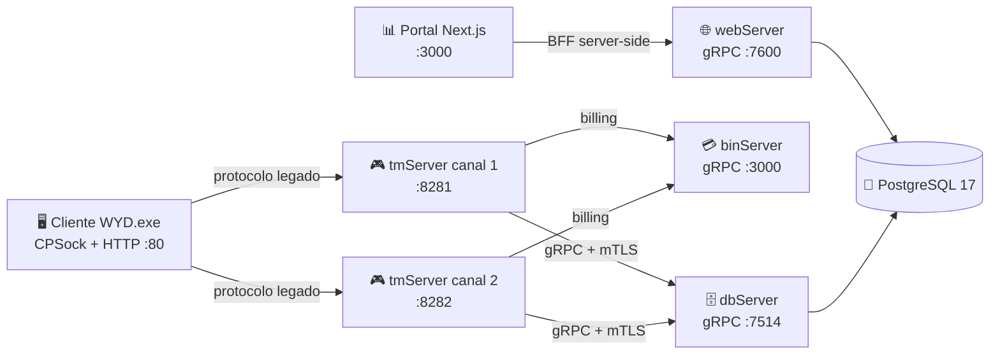

<div align="center">

# ⚔️ OpenWYD - NextGen

**Servidor de *With Your Destiny* reescrito em Go — protocolo legado, arquitetura moderna.**

[](https://github.com/Jean1dev/w2pp-OpenWYD/actions/workflows/ci.yml)
[](https://go.dev/)
[](https://nextjs.org/)
[](https://www.postgresql.org/)
[](https://grpc.io/)
[](https://docs.docker.com/compose/)
[](LICENSE)

</div>

---

## 📖 O que é este projeto

O **OpenWYD** é um servidor local do MMORPG **With Your Destiny (WYD2)** escrito em **Go**, que fala
o protocolo original com o cliente Windows `WYD.exe` (build **7662**, `ClientVersion` **12000**) e
expõe uma plataforma de administração em **Next.js**.

A reescrita é guiada por engenharia reversa documentada: os fontes C++ legados ficam em
`Source/`, os contratos de wire e de save em `docs/migration/`, e cada serviço Go nasce com teste,
gate e documentação próprios. O estado do mundo é **propriedade de uma única goroutine** — sem
locks, sem duplicação de item, como no reactor single-thread original.

> 🎯 **Objetivo:** servidor local operacional com login pelo cliente modificado, personagens,
> batalha, comércio, quests e uma camada de administração web — sem tocar no binário do cliente.

---

## 🏗️ Arquitetura



**Só a borda cliente↔tmServer fala o protocolo legado.** Todo link interno é gRPC (com mTLS
opcional). O portal é um BFF puro: lê e envia intenções, nunca escreve estado de personagem vivo.

### Serviços

| Serviço | Porta | Papel |
|---|---|---|
| 🎮 **tmServer** | `8281` / `:80` | Dono de todo o estado do mundo em memória (goroutine única). Protocolo CPSock, pathfinding, combate, drops, NPCs. |
| 🗄️ **dbServer** | `7514` | Persistência via gRPC `api/db/v1` sobre PostgreSQL/pgx v5. |
| 💳 **binServer** | `3000` | Gate de billing via gRPC `api/bin/v1`. |
| 🌐 **webServer** | `7600` | Web-api gRPC `api/web/v1` para o BFF do portal. |
| 📊 **portal** | `3000` | UI de administração em Next.js: contas, NPCs, drops, itens, mapa, faturamento. |
| 🧾 **logpipe** | `7788` | Sidecar read-only que serve logs do Docker ao portal. |

Pacotes compartilhados (`store`, `migrations`, `domain`, `secret`/argon2id) vivem em `internal/`.

---

## 🧰 Stack

| Camada | Tecnologia |
|---|---|
| 🐹 Servidor | Go 1.26, gRPC, pgx v5, argon2id |
| 🐘 Dados | PostgreSQL 17 (migrations versionadas + seeds de referência) |
| 🖥️ Portal | Next.js 16 (App Router), React 19, TypeScript, Tailwind, jose, zod |
| 🧪 Testes | `go test -race`, vitest, testes de integração com Postgres, e2e headless |
| 📈 Observabilidade | Prometheus + Grafana, logs estruturados (`slog`), `trace_id` ponta a ponta |
| 📚 Docs | MkDocs Material (`docs/`) + roadmap versionado (`roadmap/`) |
| 🐳 Deploy | Docker multi-stage, imagens distroless nonroot, compose em camadas |

---

## 🚀 Começando

### Pré-requisitos

- **Docker** + **Docker Compose** (caminho recomendado), ou
- **Go 1.26** e **Node.js 20+** para rodar no host.

### Subir a stack completa

```bash
cp .env.example .env      # primeira vez; o arquivo não é versionado
make run-local            # Postgres + serviços + 2 canais + portal, conta test/test123
```

O comando imprime o endereço para apontar o cliente. Depois:

| Onde | URL |
|---|---|
| 📊 Portal | <http://localhost:3000> |
| 🎮 Jogo (canal 1) | `127.0.0.1:8281` |
| 🌐 Status HTTP | <http://127.0.0.1/> |

### Rodar sem containers

```bash
make run                  # só o tmServer, persistência no-op
make portal-install       # npm ci em portal/
make portal-dev           # portal em http://127.0.0.1:3000 (hot reload)
```

### Conectar o cliente

1. Gere um `serverlist.bin` apontando para o IP/porta do servidor
   (`client-tools/serverlist`, alvo `make client-serverlist`).
2. Faça backup do `serverlist.bin` original e substitua-o na pasta do cliente.
3. Abra `WYD.exe`, entre com `test` / `test123` e crie um personagem.

O cliente sonda o status na porta HTTP `80` e conecta em `8281/TCP` — libere ambas no firewall
quando o cliente estiver em outra máquina. Detalhes em
[`docs/migration/canais.md`](docs/migration/canais.md).

---

## 🔧 Configuração

Toda configuração de processo vem de `./.env` (carregado pelo compose) ou de flags. **Nenhuma
chave é obrigatória** e o argumento de CLI sempre vence a variável de ambiente.

```bash
W2PP_RATES_EDITING=true docker compose up -d openwyd-nextgen1-tmsrv
```

> ⚠️ **Números de gameplay não vêm de env.** Rate, drop, preço e curva de EXP vivem no conteúdo
> (`tmserver/content/`), no banco e nos overlays auditados do portal.

Catálogo completo, portas e hardcodes: [`docs/migration/config-ops.md`](docs/migration/config-ops.md) §0.

---

## ✅ Qualidade e gates

O repositório trata qualidade como contrato executável — o CI roda exatamente o `make ci`:

```bash
make ci          # gate + skips + comentários + docs + vet + build + test + portal-test
```

| Gate | O que garante |
|---|---|
| `make gate` | Rename residual e artefatos proto em dia |
| `make check-secrets` | Nenhum segredo versionado (gitleaks) |
| `make check-skips` | Todo `t.Skip` declara motivo |
| `make check-comments` | Comentários/docstrings em português nos diretórios migrados |
| `make guias-check` | JSON de guias do portal idêntico ao `docs/` |
| `make test` | `go test -race -cover ./...` |
| `make portal-test` | `tsc --noEmit` + vitest |

**Invariantes do servidor** (dono único do estado, offsets binários explícitos, paridade de RNG,
argon2id, a web nunca escreve personagem vivo) estão em [`AGENTS.md`](AGENTS.md) §3.

---

## 🧪 Testes

```bash
make test          # unitários com race detector
make test-db       # integração contra um Postgres descartável (W2PP_TEST_DSN)
make test-e2e      # login headless contra a stack no ar (sem cliente Windows)
make test-channel  # troca de canal real (/srv 2)
make bot-test      # laboratório de bots (determinístico, sem rede)
```

Os testes e2e usam `W2PP_E2E_ADDR`, `W2PP_E2E_ACCOUNT`, `W2PP_E2E_PASSWORD` e `W2PP_E2E_VERSION=12000`.

---

## 📚 Documentação

| Preciso de… | Leia |
|---|---|
| 🧭 Topologia, portas, configs | [`docs/migration/config-ops.md`](docs/migration/config-ops.md) |
| 🔌 Protocolo CPSock e structs | [`docs/migration/protocol-spec.md`](docs/migration/protocol-spec.md) |
| 💾 Formatos de save e alinhamento | [`docs/migration/data-formats.md`](docs/migration/data-formats.md) |
| 🎲 Fórmulas de dano, EXP, drop, refino | [`docs/migration/game-rules.md`](docs/migration/game-rules.md) |
| 🔁 Fluxos ponta a ponta | [`docs/migration/flows.md`](docs/migration/flows.md) |
| 💬 Mensagens ao cliente | [`docs/migration/game-messages.md`](docs/migration/game-messages.md) |
| 📊 Estado real do que funciona | [`docs/migration/SESSION-PRIMER.md`](docs/migration/SESSION-PRIMER.md) |
| 🗺️ Planejamento e issues | [`roadmap/index.md`](roadmap/index.md) |
| 🖥️ Portal (BFF, telas, sessão) | [`portal/README.md`](portal/README.md) |
| 🤖 Convenções para agentes de IA | [`AGENTS.md`](AGENTS.md) |

Site navegável: `docker compose --profile docs up -d openwyd-mkdocs` → <http://127.0.0.1:8000>.

---

## 📁 Estrutura do repositório

```
.
├── tmserver/          # 🎮 servidor do jogo (CPSock, mundo, handlers, conteúdo)
├── dbserver/          # 🗄️ persistência gRPC
├── binserver/         # 💳 billing gRPC
├── webserver/         # 🌐 web-api gRPC
├── internal/          # 🧩 store, migrations, domínio, argon2id
├── portal/            # 📊 UI Next.js (BFF sobre o web-api)
├── api/               # 📜 contratos .proto versionados
├── docs/              # 📚 engenharia reversa, integrações e site MkDocs
├── roadmap/           # 🗺️ planejamento, issues e programa de pré-release
├── monitoring/        # 📈 Prometheus + dashboards Grafana
├── scripts/           # 🔧 gates, conteúdo, certificados, operação
└── client-tools/      # 🧰 geração de serverlist.bin
```

---

## 🔐 Segurança

- Senhas e PINs sempre em **argon2id**; texto plano é proibido, inclusive em log.
- Sessão do portal em cookie **httpOnly** assinado (HS256); o papel no cookie é dica de UI — o
  web-api revalida `account.role` em toda RPC admin.
- **`moderator_id` vem da sessão**, nunca do corpo da request (coberto por teste dedicado).
- Links internos podem usar **mTLS** (`docker-compose.mtls.yaml` + `make certs`).
- Segredos ficam em `.env` (gitignored) ou no gerenciador de secrets do deploy.

Encontrou uma vulnerabilidade? Abra uma issue privada em vez de um PR público.

---

## 🗺️ Roadmap

O estado real — o que funciona, o que está em andamento e a ordem das próximas frentes — vive em
[`roadmap/index.md`](roadmap/index.md) e no [`roadmap/PRE-RELEASE-PROGRAM.md`](roadmap/PRE-RELEASE-PROGRAM.md).
Issues detalhadas em [`roadmap/issues/`](roadmap/issues/).

---

## 🤝 Contribuindo

1. Leia [`AGENTS.md`](AGENTS.md) (invariantes) e [`development-guidelines/processo.md`](development-guidelines/processo.md)
   (Definition of Done).
2. Rode `make ci` antes de abrir o PR — gate vermelho se conserta na mudança, não no CI.
3. Commits pequenos e descritivos, em português; docs e UI também em português.
4. Nunca versione segredos, `client/`, `serverlist.bin` com IP privado ou dumps de conta.

---

## 📜 Licença

Distribuído sob a **GNU General Public License v2.0** — veja [`LICENSE`](LICENSE).

Os binários e assets do cliente WYD são propriedade dos seus respectivos donos e **não** são
distribuídos por este repositório (`client/` é ignorado pelo git).

---

## 🙏 Agradecimentos

A quem preservou e compartilhou os fontes legados, e a toda a comunidade que mantém o WYD vivo.
Sem esse material, esta reescrita não existiria.
