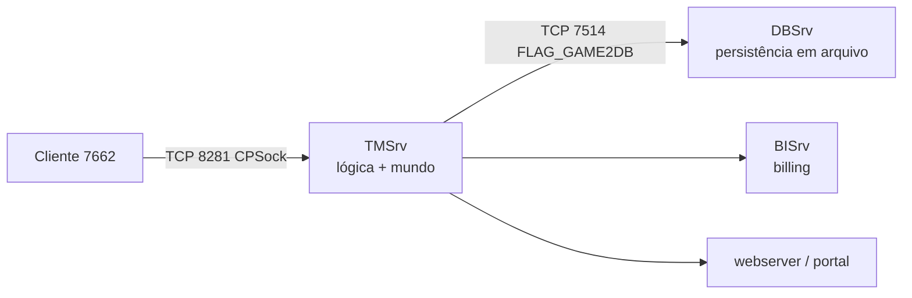

# 02 — Auditoria do legado (C++ original e reescrita Go)

> **O que é “legado” neste projeto:** a stack anterior completa — C++ da JoyImpact/HanbitSoft
> (`Source/`), a reescrita Go (`tmserver/` + `internal/`) e a plataforma web antiga. Ela **não
> está na árvore de trabalho**: vive em `origin/main` e serve como *fonte de conhecimento*, nunca
> de código (`AGENTS.md` §0).
>
> **Método desta seção:** leitura dos contratos já publicados no repositório
> (`analise-portabilidade-legado.md`, `contrato-dispatch-opcode.md`,
> `contrato-transporte-cpsock.md`, `contrato-persistencia.md`) + pesquisa externa sobre o
> repositório de referência. **Nenhum arquivo de `origin/main` foi re-medido nesta sessão**; os
> números abaixo carregam a data da medição original.

## 1. Inventário medido do legado

| Pasta | Arquivos (medido em 2026-11-08) | Papel |
|---|---:|---|
| `Source/` | 142 | C++ original: `TMSrv` (91), `DBSrv` (16), `BISrv` (10), `ClientPatch_v7662` (9), `CPSock`, `Basedef`, `ItemEffect.h` |
| `tmserver/` | 449 | servidor Go: `internal/handler` 172, `internal/world` 55, `content/TMsrv` 46, `internal/protocol` 34 |
| `internal/` | 125 | Go compartilhado + `migrations/` (22 `.sql`, 18 MB) |
| `dbserver/` + `binserver/` | 28 + 7 | persistência e billing |
| `webserver/` + `api/` + `portal/` | 94 + 12 + 186 | plataforma web anterior |
| `roadmap/` | 138 | planejamento da era Go (histórico) |
| `docs/` | 226 | conhecimento (`migration` 79, `archive` 72, `agents` 16, `analysis` 15, `sistemas` 13, `integrations` 9, `adr` 8) |

**Volume de código:** C++ **70.987 linhas** em 116 arquivos; Go **99.606 linhas** em 484
arquivos (**51.582** sem `_test.go`). Para comparação: o `crates/*/src` Rust tem **55.675**
linhas hoje — mais que o Go sem testes, menos que o C++.

**Onde mora a regra de jogo no C++** (maiores arquivos): `TMSrv/Server.cpp` (10.553),
`Basedef.cpp` (7.468), `_MSG_UseItem.cpp` (6.686), `MobKilled.cpp` (3.506),
`ProcessSecMinTimer.cpp` (2.823), `_MSG_Quest.cpp` (2.753), `DBSrv/CFileDB.cpp` (2.712),
`GetFunc.cpp` (2.286), `SendFunc.cpp` (2.145). `Basedef.h` (2.920 linhas) declara **147
structs** e todos os valores `_MSG_*`.

## 2. Referência remota × `main` local

| Item | Valor | Confiança |
|---|---|---|
| Repositório de referência | `github.com/Jean1dev/w2pp-OpenWYD` | Confirmado (pesquisa 2026-11-13) |
| Linguagem / licença | **Go**, módulo `github.com/jeanluca/w2pp-openwyd`, **GPL-2.0** | Confirmado |
| Atividade | criado 2021-01-06, **672 commits**, `pushed_at` 2026-10-29, 76 stars, ~208 MB | Confirmado |
| Alvo declarado | cliente `WYD.exe` build **7662** sem modificação; protocolo/ClientVersion **7640** | Confirmado |
| Relação com a nossa `main` | a nossa `main` preserva o mesmo projeto anterior (C++ + Go + docs), mas **não foi feito diff** contra o remoto nesta auditoria | **Divergente / não verificado** |

**Não presuma identidade.** O prompt pede explicitamente para não assumir que remoto e local são
iguais. O que se sabe: `AGENTS.md` §0 declara que a stack Go/C++ foi removida em 2026-11 e que a
`main` é o histórico preservado. Sem `git fetch` + `git diff origin/main` contra o remoto, a
diferença exata é **Desconhecida** (`UNK-01`).

## 3. Topologia do legado (o que o Rust decidiu não reproduzir)

| Classe de mensagem | Flag | Tratada em | Entra no dispatch de cliente? |
|---|---|---|---|
| Cliente → jogo | `FLAG_CLIENT2GAME` (0x0200) | `ProcessClientMessage.cpp:66` | **sim** (63 `case`) |
| Jogo → cliente | `FLAG_GAME2CLIENT` (0x0100) | `SendFunc.cpp` | não (saída) |
| Jogo ↔ DB | `0x0800`/`0x0400` | `ProcessDBMessage.cpp` (1.483 linhas) | **não** — porta 7514 |
| DB ↔ NP | `0x1000`/`0x2000` | `DBSrv`/`NPTool` | não |
| família “new” | `FLAG_NEW` (0x4000) | ranking | não |

**Consequência medida:** metade dos opcodes do legado nunca passa pelo socket do jogador. O Rust
substituiu a porta 7514 por `wyd-db` (ADR-0001/0009) — decisão registrada, não lacuna.

## 4. Mapa de sistemas do legado × destino Rust

Legenda: ✅ existe · 🚧 parcial · ❌ ausente.

| Domínio | Evidência no legado | Destino Rust | Estado |
|---|---|---|---|
| Transporte CPSock (8281, framing, sessão) | `CPSock.cpp/h`, Go `internal/protocol/*` | `wyd-server::cpsock` (+ `wyd-net` limits) | ✅ |
| Wire (HEADER, ofuscação, opcodes, payloads) | `Basedef.h`, `protocol-spec.md`, 198 Types | `wyd-protocol` | ✅ (goldens sintéticos) |
| Login / seleção / sessão | `_MSG_AccountLogin.cpp`, `_MSG_CharacterLogin.cpp` | `cpsock::{login,selection}`, `auth` | ✅ |
| Mundo: tick, grade, spawn, respawn, teleporte | `ProcessSecMinTimer.cpp` | `wyd-core::{tick,spatial}`, `world` | 🚧 (respawn/teleporte ❌) |
| Combate, morte, EXP, drop | `MobKilled.cpp`, `GetFunc.cpp` | `systems/combat.rs`, `gameplay::loot*` | 🚧 |
| Skills, affects, Arch | `_MSG_Action.cpp` | `systems/skill.rs` | 🚧 (sem fio) |
| Inventário, cargo, equipamento | `CItem.cpp`, `_MSG_{GetItem,Deposit,Withdraw,UpdateItem}.cpp` | `systems/inventory.rs` | 🚧 (sem fio) |
| Refino / combine | `_MSG_CombineItem*.cpp` (10 variantes) | `gameplay::refine` | ✅ no fio / compose sem fio |
| Comércio: loja, trade, autotrade | `_MSG_{REQShopList,ReqBuy,Sell,Trade,TradingItem,SendAutoTrade}.cpp` | `payload/commerce.rs` só | ❌ regra |
| Party, guilda, chat, duelo, PK | `_MSG_{InviteGuild,GuildAlly,AcceptParty,MessageChat}.cpp` | — | ❌ |
| Guerra, castelo, reinos, torres | `CCastleZakum.cpp`, `CWarTower.cpp`, `_MSG_War.cpp` | — | ❌ |
| Quests (story, runas, newbie, Kefra) | `_MSG_Quest.cpp` | só Campo de Treinamento (`handle_quest`) | 🚧 |
| Eventos, clima, água, nightmare | Go `worldevent.go`, `weather.go` | — | ❌ |
| IA de NPC | `CMob.cpp`, `CNPCGene.cpp` | `core/npc/*` | ✅ |
| Persistência | `DBSrv/CFileDB.cpp` (arquivos por conta) | `wyd-db` + Postgres | ✅ (modelo diferente) |
| Billing | `BISrv/` | `wyd-admin` donate (parcial) | 🚧 |
| Plataforma web | `webserver/`, `portal/` | `wyd-portal` + `wyd-admin` | 🚧 |
| Bots de carga | Go `internal/bot` (14) | `wyd-bots` | 🚧 |
| Launcher / patch | `WYDLauncher.exe`, Go `client-tools` | `wyd-launcher` | ✅ |

## 5. Regras de negócio recuperadas (com nível de confiança)

> Fonte: documentos de engenharia reversa do próprio projeto de referência
> (`docs/migration/game-rules.md`, `flows.md`, `data-formats.md`), que citam `arquivo:linha` do
> C++ **que existe** na nossa `origin/main`. **Fortemente indicado**, não reconferido nesta
> sessão. Nenhum destes números foi promovido a constante no Rust sem `wyd-sim` + teste.

| Regra | Fórmula/comportamento citado | Onde |
|---|---|---|
| Dano melee | `tdam = dam - ac/2`; `combat = min(combat/2, 7)`; `rnd = rand()%delta + combat + 99`; escada `< -50 → 0`, `0..50 → 5*tdam/4 + 7`; mínimo 1 | `Basedef.cpp:1265` |
| Dano de skill | `combat = min(combat, 15)`; `rnd = rand()%(21-combat) + combat + 90` | `Basedef.cpp:1486` |
| PvP | `Ac *= 3` contra player; crítico parcial ×1.3–1.4 (player) / ×1.5–1.6 (mob); crítico total `dam *= 2` | `_MSG_Attack.cpp:455` |
| Esquiva | `rand()%1000+1 < parryretn → dam = -3` | idem |
| EXP em grupo | `exp = 450 * isExp / (30 + myLevel)`; corte `6*exp/10`; `KefraLive == 0 → exp /= 2`; bônus de fada/item | `game-rules.md` |
| Perda de EXP na morte | divisores 22…100 por faixa (30…250); cap 150.000; ×3 se `10 < PK ≤ 25`; ×5 caso contrário, cap 30.000; <35 protegido | idem |
| Drop | `g_pDropRate`/`g_pDropBonus` **por slot do `Carry`**, não por item | `Basedef.cpp:222-238` |
| Ouro por abate | `rand()%UNKGOLD + 1`, teto 2.000 | idem |
| Refino/combine | roll de paridade `rand()%115`, fold `>=100 ⇒ -15`; tabelas `CompRate.txt` / `SancRate.txt`; pity via `g_pSuccessRate` | `_MSG_CombineItem.cpp:80-82` |
| Cadência de ataque | `MSG_Attack` 0x0367 com intervalo mínimo ≥ 800 ms, server-auth | `flows.md` |

**Armadilha registrada no projeto:** `Rates.txt` (descrição ao jogador) **não** é parseada pelo
servidor. Não usar como fonte de EXP.

## 6. Formato de dados do legado (server-side)

| Arquivo | Layout citado | Confiança |
|---|---|---|
| `ItemList.bin` (servidor) | **6.500 × 140 B**, XOR `0x5A`, sem cabeçalho (+4 B) | Fortemente indicado |
| `InitItem.csv` | `STRUCT_INITITEM` | idem |
| `HeightMap.dat` | 16.777.216 B = 4096×4096, 1 B/célula | idem |
| `AttributeMap.dat` | 1.048.576 B = 1024×1024 | idem |
| `ItemDropList.txt`, `LevelItem.txt`, `Regions.txt`, `Rates.txt`, `Settings/{CompRate,SancRate,QuestsRate}` | tabelas de configuração | idem |
| Armadilha de alinhamento | `#pragma pack`/natural: struct “igual” com tamanho diferente | idem |

> Nosso `client/ItemList.bin` tem **910.004 B = 6.500×140 + 4** — aritmética compatível com o
> layout de **servidor** acima (ver `04-client-analysis.md` §3). Isso **não** prova o layout:
> prova que a hipótese 140 B é consistente com o tamanho.

## 7. Bugs e incompletudes conhecidos do legado

| # | Item | Evidência |
|---|---|---|
| L-1 | `Basedef.h` declara `CreateItem` na direção errada (C→J) — confirmado contra o binário | `docs/cliente/pacotes.md` |
| L-2 | Quests “parcialmente operacionais, com bugs” (avaliação do prompt, coerente com `_MSG_Quest.cpp` de 2.753 linhas) | `roadmap-rust/issues/GAME-18-*.md` |
| L-3 | `NewAccountFail` (`0x0117`) existe no C++ mas **não** no cliente 7662 → mensagem morta no fio | `docs/cliente/pacotes.md` |
| L-4 | Persistência em arquivo por conta (`account/<Key>/<NOME>`), sem transação relacional | `CFileDB.cpp` |
| L-5 | `Rates.txt` descritivo confundido com configuração (armadilha documentada) | `game-rules.md` |
| L-6 | Três processos (TMSrv/DBSrv/BISrv) com protocolo próprio na 7514 — superfície extra de falha | `contrato-dispatch-opcode.md` §3 |

## 8. O que o legado ensina e o Rust ainda não usou

1. **Tabelas de taxa editáveis** (`CompRate`/`SancRate`) — o Rust já tem `SancRate` no banco
   (`0037`), mas não a cadeia +12…+15.
2. **Pity de refino** (`g_pSuccessRate`) — o Rust implementou piedade própria (`0043`), com
   semântica **nossa**, não a do legado (`DIV-06`).
3. **Cadência de ataque 800 ms** — `GAME-20` investiga “velocidade ~200%” justamente porque a
   cadência não está provada no fio.
4. **Drop por slot do `Carry`** — o Rust sorteia por item da tabela do snapshot; a diferença é
   de modelo, não de número (`DIV-05`).
5. **Guerra/castelo/reinos** — 100% ausente; é o maior bloco de conhecimento não portado.
