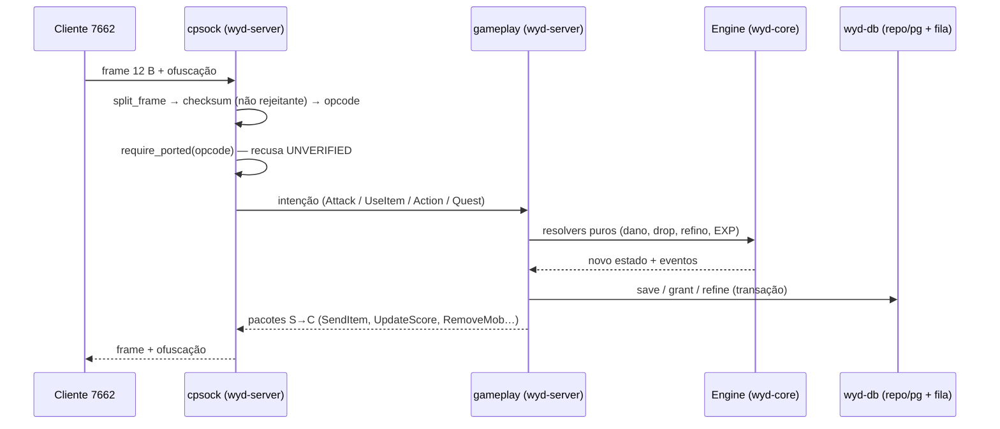

# 03 — Auditoria da implementação Rust

> Medições de 2026-11-13 sobre `crates/` (9 crates, 202 arquivos em `src`, 55.675 linhas,
> 810 testes). Comportamento em runtime **não** foi executado nesta sessão.

## 1. Mapa por crate

| Crate | Papel real (lido do código/índice) | Força | Fraqueza |
|---|---|---|---|
| `wyd-protocol` | HEADER 12 B, `INITCODE`, tabela `pKeyWord` (512 B), opcodes, payloads por domínio, `require_ported` | goldens + `repr(C)` provado por offset | só 5 fixtures C→S; S→C quase todo `Unported` |
| `wyd-core` | tick determinístico, ECS contíguo, spatial grid, combate/skill/inventário/compose puros, IA de NPC com orçamento | testado e determinístico (`integracao_determinism`) | regras puras que não chegam ao fio |
| `wyd-net` | limites, rate-limit, handshake, métricas | hardening desde o handshake | **não** é o transporte real: `cpsock` mora em `wyd-server` |
| `wyd-db` | pool sqlx, migrations no boot, repos (accounts, characters, economy, grants, content), `delivery_queue` | transações e idempotência (`idempotency_key UNIQUE`) | sem teste de contrato para toda repo; sistêmico exige Postgres |
| `wyd-admin` | gateway HTTP/JSON: contas, catálogo, economia, eventos, grants, moderação, presença, PIN | contrato + auditoria + auth de staff | alguns endpoints só leitura; atributos no gateway pendentes |
| `wyd-server` | composição: boot, canais, `cpsock` (handshake, login, selection, action, dispatch), `world` (tick, cena, save), `gameplay` | é onde o jogo acontece; 28 arquivos de teste | concentra 13.225 linhas — maior superfície de regressão |
| `wyd-sim` | fórmulas determinísticas (dano, hit, drop, refino, progressão, resist, regen, ameaça, chaos) | golden de fórmulas + seed | fórmulas ainda **não** são as do legado (`4.2` ⛔) |
| `wyd-launcher` | manifesto, patch atômico, Ed25519, `serverlist`/`sn.bin`, branding, `wyt` retheme | 140 testes, paridade de bytes com Node | GUI Tauri não existe; `retheme` sem teste |
| `wyd-bots` | cliente de protocolo sem GUI, 4 raças, campanha de 4 etapas | prova de fio sem cliente gráfico | sem carga de 200 jogadores (`QA-11`) |

## 2. Fluxo real de uma requisição de jogador

O desenho respeita o invariante 1 do `AGENTS.md` (Hot Path sem I/O): o tick não chama banco; a
persistência entra por canais/traits fora do laço.

## 3. O que está ligado ao fio (medido pelo checklist)

| Resolvedor | Entrada | Ligado? |
|---|---|---|
| `Gameplay::refine` | `Opcode::UseItem` → `SelectionStore::use_item` | **Sim** (grava item + piedade, emite `SendItem`) |
| `Gameplay::loot_at_death` | `Opcode::Attack*` → `Engine::attack_at` | **Sim até o inventário**; sem caixa no chão/pickup |
| `Gameplay::exp_reward` | `Opcode::Attack*` → `gain_exp` | **Sim** (`UpdateEtc`/`UpdateScore`) |
| `Gameplay::drop_rule` | portal → `config_revision` → `LiveConfig` | **Sim** (peso novo no próximo roll) |
| `core/systems/skill.rs` | nenhum | **Não** — falta payload de uso de skill |
| `core/systems/compose.rs` | nenhum | **Não** — falta layout de `_MSG_CombineItem` |
| `core/systems/inventory.rs` | leitura no `_MSG_CharacterLogin` | **Parcial** — sem pacote de mover/equipar/vender |
| `core/npc/{brain,behavior}` | tick | **Sim (interno)** — nenhum pacote de ação de NPC sai |

> Fonte: `docs/rust/08-checklist-funcionalidades.md` §5.11, conferido contra
> `crates/wyd-server/src/cpsock/*` e `gameplay/service.rs`.

## 4. Pontos de fragilidade medidos

| Item | Medida | Leitura |
|---|---:|---|
| `unwrap()` em `src` | **124** | Não é `panic!` em entrada de rede (o parse é explícito), mas cada um é um ponto de queda em invariante assumido. Candidato a `expect` com contexto ou `?`. |
| `unwrap()` em `tests` | 36 | Aceitável. |
| `unsafe` | **0** | Confirmado: as 5 ocorrências são comentários afirmando ausência. |
| `TODO/FIXME/todo!/unimplemented!` | **16**, todos em `tests/contrato/*` | São stubs de “fora do escopo deste teste”, não dívida de produção. |
| `require_ported` | gate ativo | `payload/mod.rs:219`; teste `require_ported_rejects_unverified_layout`. **Não afrouxar.** |
| Concentração | `wyd-server` = 24% do LOC | maior risco de conflito e de regressão |

## 5. Implementações “prontas” que não são funcionais

1. **`systems/compose.rs`** — mix resolve no core, sem opcode e sem emissão: para o jogador, não
   existe.
2. **`systems/skill.rs`** — custo, cooldown e alcance validados em `integracao/autoridade.rs`;
   nenhum pacote de skill chega ao cliente.
3. **`systems/inventory.rs`** — move/equip testados no core; o fio só lê o inventário no
   `STRUCT_MOB`.
4. **`wyd-launcher retheme`** — CLI de re-tema `.wyt` sem teste de ida-e-volta (só `--dry-run`).
5. **`snapshot de conteúdo`** — catálogo e seeds ✅ como **dado**; “regra implementada” é outra
   coluna e continua ⬜ em vários sistemas (regra de ouro do checklist).

## 6. Dados provisórios declarados (não são bug, são dívida consciente)

| Item | Providório | O que falta |
|---|---|---|
| `STRUCT_SELCHAR` (tela de personagens) | layout `rust-v1` | offsets do 7662 (`docs/cliente/captura-selchar.md`) |
| `STRUCT_MOB` S→C | corpo portado de `Basedef.h` + Go | captura ao vivo |
| `MSG_Trade` | 156 B (natural) × 154 B (Go `pack(1)`) | frame real (`CLIENT-10`) |
| id de item no chão | faixa não confirmada | `CreateItem`/`GetItem` no cliente (`CLIENT-06`) |
| `change_numeric` do `0x0FDE` | fluxo em 2 etapas é **decisão nossa** | semântica oficial |
| Piedade de refino | semântica nossa (`0043`) | comparar com `g_pSuccessRate` |

## 7. Dívidas de arquitetura

| # | Dívida | Evidência | Severidade |
|---|---|---|---|
| A-1 | Transporte CPSock em `wyd-server`, não em `wyd-net` — `wyd-net` (833 LOC) é quase só limites | `ls crates/wyd-net/src` | Média (fronteira ADR-0002) |
| A-2 | `payload/` sem cobertura S→C: 198 opcodes, 5 fixtures C→S | `crates/wyd-protocol/tests/fixtures/cliente` | Alta (é o bloqueio de paridade) |
| A-3 | Regras puras × fio: 4 de 8 resolvedores sem opcode | §3 | Alta |
| A-4 | `wyd-sim` é o único lugar de fórmula, mas o core tem cópia de lógica simples de combate | `systems/combat.rs` × `formula/damage.rs` | Média (duplicação) |
| A-5 | Migrations no boot (ADR-0024) acoplam subida a schema | `boot/` | Baixa (decisão) |
| A-6 | Documentação desatualizada em relação ao código (7 crates/458 linhas vs 9/833) | `15-bugs-and-divergences.md` `DIV-08` | Baixa |

## 8. Testes: o que a contagem não diz

- 810 testes é um número **alto** e a distribuição é boa (`wyd-core` 165, `wyd-server` 151,
  `wyd-launcher` 140, `wyd-sim` 120).
- Mas o eixo **protocolo S→C** tem 3 arquivos de teste e 5 fixtures: a assimetria de testes
  espelha a assimetria de conhecimento.
- Testes de sistema exigem Postgres (`WYD_TEST_REQUIRED=1`, `make sistema-test`, zero SKIP). Sem a
  stack, eles **não rodam** — esta auditoria não os executou.
- Detalhe de estratégia: `16-test-strategy.md`.

## 9. Veredito do crate

| Pergunta | Resposta |
|---|---|
| O servidor Rust “existe”? | **Sim**, no caminho login→cena→combate/drop→refino→logout, com prova de fio em loopback. |
| Está “portado”? | **Não** no sentido do prompt: 10+ sistemas têm zero linha, e 4 resolvedores prontos não têm opcode. |
| A arquitetura aguenta evoluir? | **Sim**, com uma ressalva: o fio S→C é o gargalo de conhecimento e está sub-testado. |
