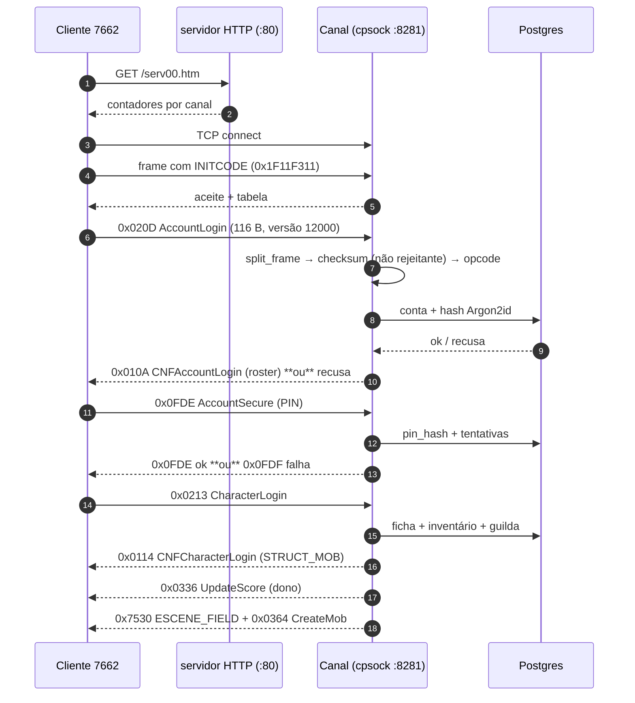
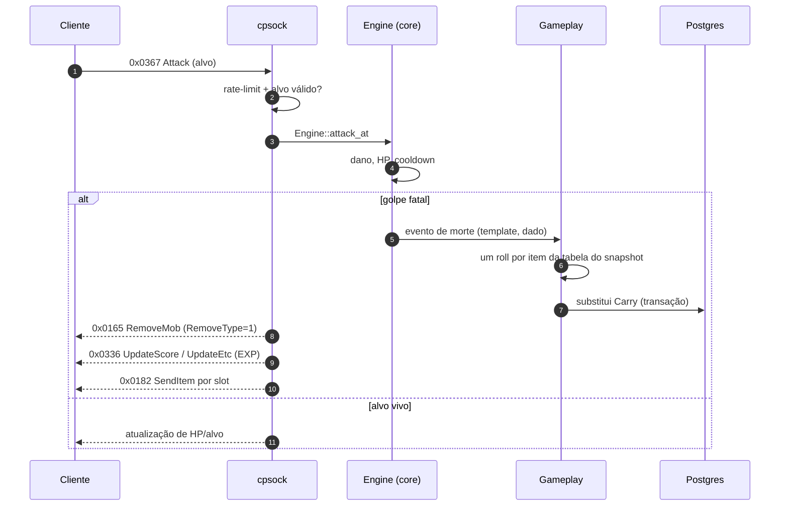
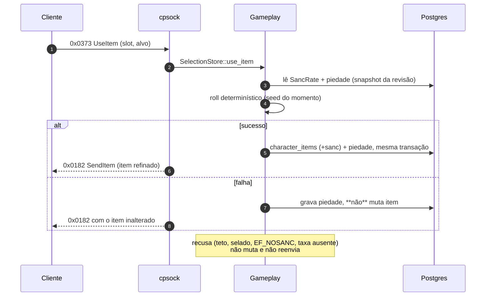
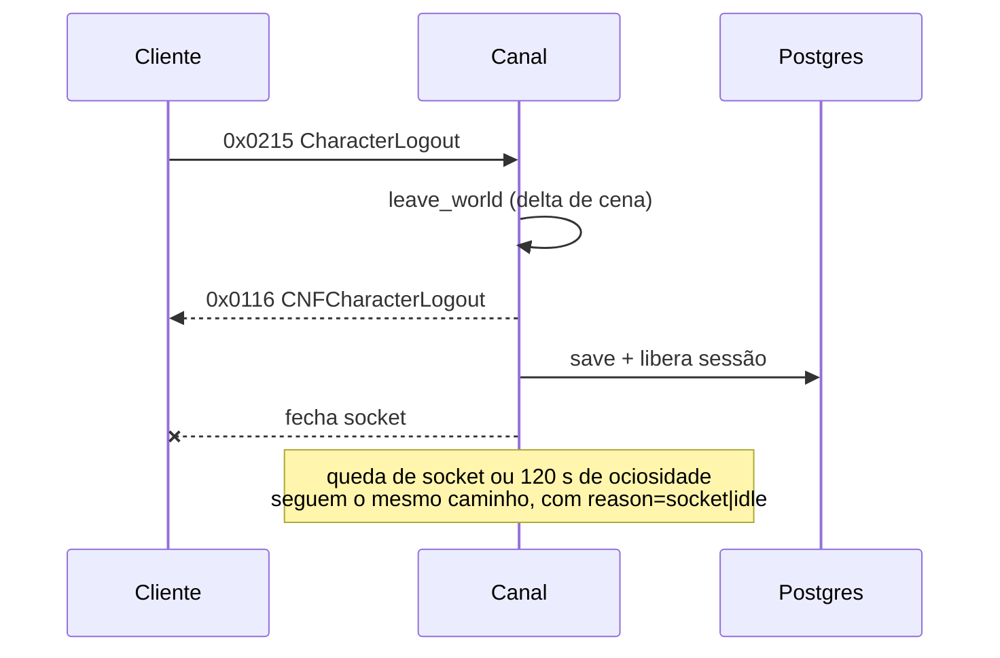
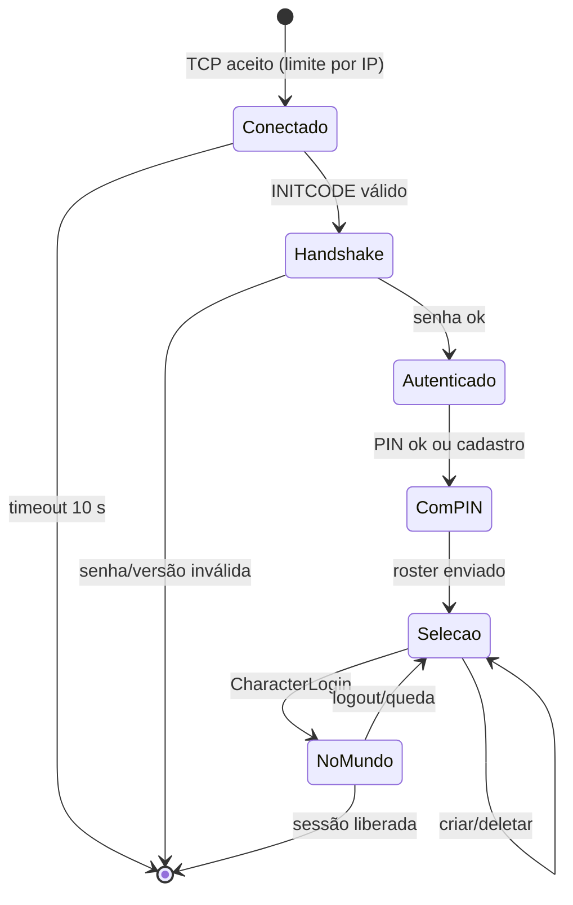

# 07 — Fluxos de comunicação e eventos

> Fluxos reconstruídos a partir de `docs/cliente/pacotes.md`, `docs/arquitetura/protocolo.md`,
> `crates/wyd-server/src/cpsock/*` e `docs/rust/08-checklist-funcionalidades.md`.
> **Nenhum fluxo foi observado em runtime nesta sessão.** Onde o estágio não existe, está escrito
> **N/A** em vez de inventado.

## 1. Entrada: status → handshake → conta → PIN → personagem → mundo

### 1.1 Estágios (modelo de 20 passos do prompt)

| # | Estágio | Existe? | Onde |
|---:|---|---|---|
| 1 | Ação do jogador | sim | clicar servidor, digitar conta/PIN, escolher personagem |
| 2 | Evento do cliente | sim | rotinas de UI + `SendPacket 0x54DA23` |
| 3 | Validação local | parcial | cliente limita tamanho de texto; **não** valida credencial |
| 4 | Estrutura preparada | sim | structs do `Basedef.h` |
| 5 | Pacote construído | sim | `memset` + campos (padrão visto no desassemblage) |
| 6 | Serialização | sim | LE, strings NUL |
| 7 | Envio | sim | TCP 8281 |
| 8 | Recepção no servidor | sim | `cpsock::serve_listener_with_limit` |
| 9 | Identificação | sim | `split_frame` + `Opcode` |
| 10 | Desserialização | sim | payloads `repr(C)` |
| 11 | Validação do servidor | sim | tamanho, versão, limites, rate-limit |
| 12 | Regra de negócio | sim | `auth`, `character`, `gameplay` |
| 13 | Mudança de estado | sim | sessão, entidade, `Carry` |
| 14 | Persistência | sim | `wyd-db` (fora do tick) |
| 15 | Resposta | sim | `reply_with_body` / frames S→C |
| 16 | Recepção no cliente | sim | roteador de 91 `cmp` |
| 17 | Atualização de UI | **parcial** | `0x0101` para texto; roster depende de layout |
| 18 | Efeito visual/sonoro | **não provado** | depende de `ESCENE_FIELD` renderizar |
| 19 | Tratamento de erro | **divergente** | `0x0117` não existe → silêncio (`DIV-03`) |
| 20 | Exceção | parcial | queda de socket, timeout de 10 s, sessão órfã |

## 2. Combate → morte → drop → inventário

| Observação | Estado |
|---|---|
| Cadência mínima de 800 ms (legado) | **não provada** no Rust (`GAME-20`) |
| Dano autoritativo (pacote forjado recusado) | ✅ `integracao/autoridade.rs` |
| Drop por item × drop por slot do legado | **divergente** (`DIV-05`) |
| Caixa no chão / pickup | ❌ (`PKT-0x026E`/`0x0270` sem handler) |
| Respawn do mob | ❌ (só recarga de definição) |

## 3. Refino (uso de item)

| Regra | Estado |
|---|---|
| Taxa lida por tentativa do snapshot | ✅ (`config_gameplay.rs`) |
| Piedade persistida | ✅ (`0043`, `refino_piedade.rs` 5/5) |
| Recusa sem mutação | ✅ |
| Cadeia +12…+15 | ❌ (`PAR-ITM-03`) |
| Estatística +25AC/+40dmg do B16 | **Desconhecido** |

## 4. Saída e queda

| Evento | Log | Persistência |
|---|---|---|
| Logout explícito | `event=logout result=ok reason=explicit` | save + sessão liberada |
| Queda | `reason=socket` | idem |
| Ociosidade 120 s | `reason=idle` | idem |
| Servidor cheio | `wyd_packets_rejected_total{reason="canal_lotado"}` | nada |
| Manutenção | `reason="manutencao"` | nada |
| Limite por IP | `wyd_ip_limit_refusals_total` + resumo a cada 25 | nada |

## 5. Mapa de eventos

### 5.1 Eventos de servidor (internos, com efeito observável)

| Evento | Produtor | Consumidor | Efeito |
|---|---|---|---|
| `death` | `Engine::attack_at` | `Gameplay`, log | remove mob, resolve loot |
| `loot` | `Gameplay::loot_at_death` | `Carry`, `SendItem` | item no inventário |
| `exp` | `gain_exp` | `UpdateEtc`/`UpdateScore` | EXP/nível |
| `refine` | `Gameplay::refine` | DB + `SendItem` | sanc/piedade |
| `grant delivered` | dreno de `delivery_queue` | portal/canal | ouro ou item entregue |
| `config reload` | portal → `config_revision` | `LiveConfig` | peso de drop/taxa muda sem restart |
| `world tick` | thread do tick | `Engine` | movimento/IA/cena |
| `channel boot` | `boot/` | log + `/health` | papel, capacidade, PvP |

### 5.2 Eventos de jogo ainda **sem** implementação

| Evento | Sistema | Consequência da ausência |
|---|---|---|
| troca de mapa/teleporte | Mundo | jogador não viaja |
| entrada/saída de guilda | Social | roster só leitura |
| guerra/cerco agendado | Guerra | nenhum ciclo |
| evento sazonal/calendário | Eventos | mundo estático |
| progresso de quest | Quests | só o Campo de Treinamento |
| morte de jogador (PvP) | Combate | sem penalidade/chaos |
| level up com bônus de ponto | Personagem | pontos não distribuíveis |
| item quebrado/durabilidade | Itens | nenhum dreno |

## 6. Máquina de estados da sessão

Estados sem transição implementada: `Manutencao` e `Lotado` são recusas **antes** do handshake
(não são estados de sessão), e `Reconexao` não existe como estado — reconectar é uma sessão nova.

## 7. Fluxos que o prompt pede e **não** existem hoje

| Fluxo | Situação |
|---|---|
| Comércio jogador↔jogador (janela, confirmação, troca atômica) | ❌ |
| Loja de NPC (abrir, comprar, vender, saldo) | 🚧 (existe teste de loja viva; ver `DIV-09`) |
| Quest (aceitar, progresso, entregar) | 🚧 (só Campo) |
| Party (convite, aceite, EXP compartilhada) | ❌ |
| Guilda (criar, convidar, cargos, sair) | ❌ |
| Guerra (agendamento, torre, cerco) | ❌ |
| Teleporte/portal | ❌ |
| Baú (depositar, retirar) | ❌ |
| Chat (geral, whisper, filtro) | ❌ |

Esses fluxos estão na matriz (`05-feature-parity-matrix.md`) com status e dependência; aqui eles
aparecem só para deixar claro **quais diagramas ainda não podem ser desenhados com evidência**.
